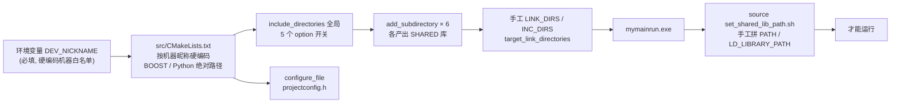
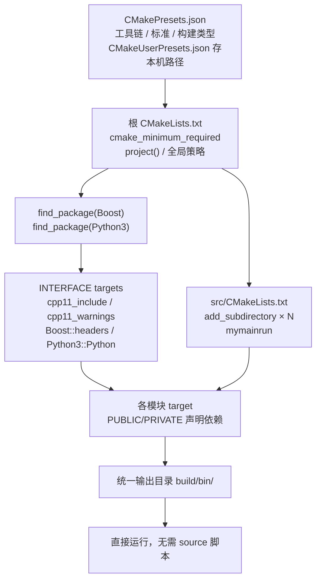

# cpp11 编译配置评审与改进建议（待确认稿）

| 项目 | 内容 |
| --- | --- |
| 文档状态 | **阶段 1–5 已执行（2026-11-15）**，阶段 6 部分执行。本文写作当时只提出建议、未修改任何文件；实际落地内容、决策取舍与验证结果见仓库根的 `OPTIMIZATION_REPORT.md`。§1.3 的「cmake 不在 PATH / build 目录不存在」是写作时的环境快照，现已不成立 |
| 生成日期 | 2026-11-14 |
| 扫描范围 | `D:/Pyrad/Gitee/cpp11` 全目录（含 `src/`、`no_use/`、根级脚本与文档） |
| 文档定位 | 供你逐条确认、批注、提出修改意见；确认后再按第 4 节的顺序执行 |
| 文件名说明 | 采用英文文件名，避免 Gitee / GitHub 双仓库同步时中文文件名的编码差异 |

> **如何使用本文档**
> 1. 先看第 0 节速览和第 2 节诊断，核对「证据」列里的文件与行号是否属实。
> 2. 对第 6 节「待确认决策点」逐条给出选择或否决意见（这些是会影响整体架构、必须先拍板的问题）。
> 3. 确认后按第 4 节 **阶段 0 → 阶段 6** 顺序执行；每个阶段都自带验收标准与回滚方式，可分段暂停。
> 4. 第 5 节是命令速查，第 7 节是风险提示，第 8 节是完整索引。
>
> **约定**：文中 `<REPO_ROOT>` 指仓库根目录，当前值为 `D:/Pyrad/Gitee/cpp11`（MSYS2 路径写法 `/d/Pyrad/Gitee/cpp11`）。README 中遗留的 `/d/Gitee/cpp11` 是旧路径，见 P3-2。

---

## 0. 一页速览

| 级别 | 问题数 | 典型症状 | 对应阶段 |
| --- | --- | --- | --- |
| **P0 正确性** | 8 | 配置即报错、option 组合构建失败、产物名与运行脚本对不上、生成的配置头含空宏 | 阶段 1 |
| **P1 可移植性** | 7 | 换机器必须改 CMakeLists、Boost/Python 全靠硬编码路径、运行时必须手动 source 脚本 | 阶段 2、3、4 |
| **P2 可维护性** | 8 | 新增源文件要改多处、项目叫 cpp11 却固定 C++14、无警告选项、无 Presets | 阶段 5 |
| **P3 清理** | 4 | 旧 Makefile 体系残留、README 与现状漂移、`.gitignore` 不全 | 阶段 6 |

**最值得优先处理的 3 件事**（不改架构、收益最大）：

1. `cmake_minimum_required(VERSION 3.10)` 与实际使用的 `target_link_directories`（需 ≥ 3.13）不符 → P0-1。
2. `-DENB_NORMAL=OFF` 这类开关在 README 中被明确宣传可用，但 `src/pyrun/CMakeLists.txt` 无条件把 5 个模块名写进链接列表，关掉任一开关就会导致链接失败 → P0-4。
3. `projectconfig.h.in` 引用了从未定义的 `@CPP11_VERSION_MAJOR@` / `@CPP11_VERSION_MINOR@`，生成的头文件是 `#define CPP11_VERSION_MAJOR `（空宏）→ P0-2。

**一句话结论**：现有 CMake 配置能跑通「所有开关全开 + 指定几台已知机器 + 手工 source 脚本」这一条窄路径，但依赖关系没有通过 target 传递，而是靠硬编码路径、全局 include 和外部脚本拼接；只要换机器、关开关或新增源文件就容易断。改进方向是 **「让 CMake 自己知道依赖，让产物自己能被找到」**。

---

## 1. 现状扫描结果

### 1.1 构建体系全貌

| 路径 | 角色 | 当前状态 |
| --- | --- | --- |
| `src/CMakeLists.txt` | **实际顶层配置**（421 行） | 项目根没有 CMakeLists，必须从 `build/` 里执行 `cmake ../src` |
| `src/EffectiveModernCpp/CMakeLists.txt` | 34 个 item 源文件 → `SHARED` 库 | 手工列全 34 个 `.cpp` |
| `src/boosttest/CMakeLists.txt` | `boosttest.cpp` → `SHARED` 库 | Boost 只用到头文件 |
| `src/cppfeatures/CMakeLists.txt` | `lvalue_rvalue.cpp` → `SHARED` 库 | — |
| `src/normal/CMakeLists.txt` | `normal.cpp`、`maintest.cpp` → `SHARED` 库 | — |
| `src/utilities/CMakeLists.txt` | `utilities.cpp` → `SHARED` 库 | `utilities.cpp` 实为空文件，内容全在 `utilities.hpp`，本质是 header-only |
| `src/pyrun/CMakeLists.txt` | 250 行，产出 `pyrun`、`cpp11runtest`、`winmingwrun` 三个 `SHARED` 库 + 拷贝 `run.py` | 问题最集中的文件 |
| `src/pymods/CMakeLists.txt` | 拷贝 `top.py` | **死配置**：未被 `add_subdirectory`，且引用了本文件内未定义的变量 |
| `src/projectconfig.h.in` | 生成 `projectconfig.h`，导出 5 个 `ENB_*` 宏 | 2 个版本宏变量未定义 |
| `set_shared_lib_path.sh` | 手工把各 DLL 目录追加进 `PATH` / `LD_LIBRARY_PATH` | 依赖 `DEV_NICKNAME`，硬编码 5 个 DLL 名 |
| `utils.config.sh` | 提供 `find_boost_version_str()` | 只被 `no_use/configure.sh` 使用 |
| `gen_emcxx_new_chapter.sh` | 生成新的 chapter/item 文件对 | **不会**同步更新 CMakeLists 与 `effectiveModernCpp.cpp` |
| `cmakeMyTest.cmake` | `cmake -P` 脚本，打印主机/编译器/Python 信息 | 与主构建无关，是 CMake 特性试验品 |
| `no_use/{configure.sh,run.sh,template.makefile,Makefile.mak}` | 早期 Makefile 构建体系 | 已弃用但仍在仓库中 |
| `README.md` | 构建/运行说明（约 500 行） | 大量路径与 Python 版本已过时 |
| `.gitignore` | 忽略 `build/`、`*.so`、`*.dll`、`compile_commands.json` 等 | 未覆盖 `.pyd`、`CMakeUserPresets.json`、`out/` 等 |

### 1.2 当前构建与运行链路



**关键观察**：`F`、`H` 两步都是「CMake 本来能自动做、但当前用手工路径重做了一遍」；`A`、`B` 则是「本应由 `find_package` 完成的事被写死在配置里」。这三条正是后续所有改进的主线。

### 1.3 本次实测环境（只读检查，未执行构建）

| 项 | 结果 |
| --- | --- |
| 工作区 / 分支 | `D:/Pyrad/Gitee/cpp11`，`master` |
| `git status --short` | 干净，无未提交改动 |
| `build/` 目录 | **不存在**，仓库中尚无构建产物 |
| `g++` | 可用，`g++.exe (x86_64-win32-seh-rev0, MinGW-Builds project) 15.2.0` |
| `mingw32-make` | 可用，位于 `/d/proc/mingw64-15.2.0-win32-seh-msvcrt-rt_v13-rev0/bin/` |
| `cmake` | **不在当前 Git Bash 的 PATH 中**（`command not found`） |
| `ninja` | **不在当前 Git Bash 的 PATH 中** |
| 常见安装位置 | `/c/Program Files/CMake/bin/cmake.exe`、`/d/procs/msys64/mingw64/bin/{cmake,ninja}.exe` 均未找到 |

> **直接后果**：第 4 节阶段 0 的「基线构建」无法在当前这个 shell 里直接跑通，需先准备好 CMake/Ninja（命令见 5.1）。这一点也印证了 P1-1：项目构建强依赖特定机器的特定环境，缺少可复现的工具链声明。

### 1.4 现有配置要点

- C++ 标准固定 `CMAKE_CXX_STANDARD 14` + `STANDARD_REQUIRED True`，**未设 `CMAKE_CXX_EXTENSIONS OFF`**（实际使用 `-std=gnu++14`）。
- 6 个子目录全部硬编码 `SHARED`，没有 `BUILD_SHARED_LIBS` 开关。
- 5 个 `option(ENB_*, ..., ON)` → `#cmakedefine ENB_*` → 源码 `#ifdef` 条件编译，设计意图良好。
- 依赖库通过全局 `include_directories(${BOOST_INCLUDEDIR})` + `target_link_directories` 手工指定的 build 子目录传递。
- 运行时依赖通过 `set_shared_lib_path.sh` 手工拼接，README 也用 `export PATH=...` 手动教学。

---

## 2. 问题诊断（按严重度分级）

> 「证据」列均可直接打开核对。行号基于本次扫描时的文件内容。

### P0 —— 正确性 / 会直接导致构建或运行失败

#### P0-1 声明的最低 CMake 版本低于实际所需

- **证据**：`src/CMakeLists.txt:15` `CMAKE_MINIMUM_REQUIRED(VERSION 3.10)`；同文件 `:394`、`:406`，`src/pyrun/CMakeLists.txt:64,119,247` 使用了 `target_link_directories`（CMake **3.13** 引入）；`cmakeMyTest.cmake:79` 使用 `find_package(Python3 ...)`（3.12 引入）。
- **影响**：用 CMake 3.10–3.12 配置时直接报 Unknown CMake command；策略（CMP0079 等）行为也与新版本不一致，声明值形同虚设。
- **建议**：最低版本不低于 3.13；推荐 **3.16**（Ubuntu 20.04 自带 3.16.3，且 `Boost::headers` 可用）或 **3.21**（可用 `$<TARGET_RUNTIME_DLLS>` 自动拷贝 DLL）。具体取值见决策点 D2。

#### P0-2 配置头引用未定义变量，生成空宏

- **证据**：`src/projectconfig.h.in:2-3` 使用 `@CPP11_VERSION_MAJOR@` / `@CPP11_VERSION_MINOR@`；`src/CMakeLists.txt:18` 写的是 `PROJECT(MYCPP11TEST VERSION 0.1)`，会生成 `MYCPP11TEST_VERSION_MAJOR`、`PROJECT_VERSION_MAJOR`，**不存在 `CPP11_VERSION_*`**；全仓库 Grep 无任何定义点。
- **影响**：`configure_file` 把未定义变量替换为空串，生成的 `projectconfig.h` 含 `#define CPP11_VERSION_MAJOR `。目前恰好没有代码使用它所以没爆，但一旦有人写 `CPP11_VERSION_MAJOR >= 1` 就是难以定位的编译错误。
- **建议**：改用 `@PROJECT_VERSION_MAJOR@` / `@PROJECT_VERSION_MINOR@`；`configure_file` 加 `@ONLY`，避免源码中的 `${...}` 被意外替换。

#### P0-3 `src/pymods/CMakeLists.txt` 是坏的死配置

- **证据**：该文件 `:10` 使用 `add_custom_command(TARGET ${CurSharedLibName} POST_BUILD ...)`，但 `CurSharedLibName` 只在 `src/pyrun/CMakeLists.txt:2` 定义（目录作用域不共享），此处为空；`:12` 拼出的路径会变成 `src//top.py`。同时 `src/CMakeLists.txt` 的 `add_subdirectory` 只有 6 处（301/315/327/339/351/363），**没有 `pymods`**，所以该文件当前根本不会被加载。
- **影响**：现在无害，但任何人「顺手启用这个目录」都会立刻配置失败；`src/pymods/top.py` 也从未被拷贝到 build 目录。
- **建议**：二选一 —— (a) 明确删除/归档该目录；(b) 修正为独立 target 或 `add_custom_target` + `configure_file(... COPYONLY)`，并加入 `add_subdirectory`。见 D4。

#### P0-4 option 开关与 pyrun 的硬编码库列表冲突（**影响面最大的一项**）

- **证据**：`src/CMakeLists.txt:311,323,335,347,359` 定义 5 个 `option` 并按条件 `add_subdirectory`；但 `src/pyrun/CMakeLists.txt:108` 的 `CUSTOM_LIB_LIST` 与 `:209-227` 的 `LIB_LIST` **无条件**写入 `"utilities" "normal" "boosttest" "cppfeatures" "EffectiveModernCpp"`，`:118`、`:236` 拿去 `target_link_libraries`。
- **影响**：README:125-141 明确教用户 `cmake -G Ninja ../src -DENB_NORMAL=OFF`。实际执行时 `normal` target 不存在，CMake 会把字符串当裸库名传成 `-lnormal`，**MinGW/GCC 链接阶段失败**；关闭 `ENB_BOOSTTEST` / `ENB_CPP_FEATURES` / `ENB_EFFECTIVE_MODERN_CPP` 同理。此外 `winmingwrun.cpp:65-145` 虽有 `#ifdef` 保护调用，但链接列表没保护，前后不一致。
- **建议**：把 pyrun 的库列表改为按 `if(TARGET xxx) list(APPEND ...)` 或 `if(ENB_XXX)` 组装；更彻底的做法是阶段 3 用 `target_link_libraries` 显式声明依赖并让开关控制 add_subdirectory 的连带关系。

#### P0-5 `CUSTOM_LINK_DIRS` 拼写错误，实际恒为空

- **证据**：`src/pyrun/CMakeLists.txt:111` `set(CUSTOM_LINK_DIRS "")`，但 `:112-116` 追加的是 `LINK_DIRS`（少了 `CUSTOM_` 前缀），`:119` 使用的却是 `${CUSTOM_LINK_DIRS}`（空）。另外 `:245` `list(APPEND LINK_DIRS ${Python3_LIBRARIES})` 把**库文件**当成**链接目录**塞进去。
- **影响**：`cpp11runtest` 的链接目录声明完全失效，只是因为同目录 target 恰好能被 CMake 找到才没暴露；换生成器/换平台即断。
- **建议**：阶段 3 整体删除这些手工 link directories（用 target 名链接即可），阶段 1 先至少修掉变量名与误加项。

#### P0-6 产物命名与运行脚本 / 文档三者不一致

- **证据**：
  - `src/pyrun/CMakeLists.txt:39-48,53,98,195`：`pyrun`、`cpp11runtest`、`winmingwrun` 一律 `PREFIX ""` + `SUFFIX .pyd`(Windows) / `.so`(Linux)。
  - 但 `set_shared_lib_path.sh:183` 查找 `libpyrun.dll`、`libcppfeatures.dll` 等带 `lib` 前缀的 DLL；README:366-410 用的是 `libpyrun.dll`；README:446-498 与 `src/pyrun/run.py:19` 用的是 `winmingwrun.dll` / `libwinmingwrun.dll`。
- **影响**：按当前 CMake 配置，Windows 下产物应为 `pyrun.pyd` / `winmingwrun.pyd`，脚本里找 `libpyrun.dll` 必然找不到；`winmingwrun` 并非 Python 扩展模块（是给 `ctypes` 用的普通 DLL），套 `.pyd` 后缀在语义上也是错的。三处命名互相矛盾，说明其中至少两处已过时。
- **建议**：按 D5 统一命名。倾向方案：`cpp11runtest` 保留 `.pyd`/`.so`（确实是 `import cpp11runtest` 用的模块）；`pyrun`、`winmingwrun` 恢复平台默认 DLL/SO 命名；同步更新 `run.py`、README 和 `set_shared_lib_path.sh`。

#### P0-7 `set_shared_lib_path.sh` 的 shebang 与语法不匹配

- **证据**：`:1` `#!/bin/sh -`，但全文使用 `function`（:46）、bash 数组（:45,183）、`[[ ]]`（多处）、`declare -a`（:35-37）、`$BASH_SOURCE`（:155）—— 这些都是 bash 专有。`no_use/run.sh:1` 同样是 `#!/bin/sh -` 却用 `[[ ]]`。
- **影响**：虽然脚本设计为被 `source`（`:154-158` 会拒绝直接执行），但其自检本身依赖 `$BASH_SOURCE`，在 `sh` 下为空会误判；任何用 `sh` 显式调用的场景都会出语法错误。
- **建议**：改成 `#!/usr/bin/env bash`，并在文件头注释里写死「只能 `source`，不能执行」。阶段 3 之后此脚本可整体降级为兼容兜底。

#### P0-8 平台判断分支会误拒编译器 / 存在死分支

- **证据**：`src/CMakeLists.txt:241-260`。`if(${CMAKE_SYSTEM_NAME} STREQUAL "Windows" AND ${MINGW} EQUAL 1)` 只放行 MinGW；`:255` `elseif(${UNIX} STREQUAL "Unix")` 中 `UNIX` 是布尔量（`1`/空），**永远不会等于字符串 `"Unix"`**，是死分支；落到 `:259` 直接 `FATAL_ERROR`。
- **影响**：MSVC、macOS、Clang-CL 等一切非 MinGW 且非 Linux 的环境都被无条件拒绝；而 `SYS_PLATFORM` 其实已在 `:141-229` 由 `DEV_NICKNAME` 给出，这段判断纯属重复且有害。
- **建议**：整段删除；确实需要平台差异时用 `if(WIN32) / if(APPLE) / if(UNIX) / if(MSYS)` 或生成器表达式，不要用机器昵称推断平台。

---

### P1 —— 可移植性 / 依赖管理

#### P1-1 `DEV_NICKNAME` 硬编码绝对路径，且两处白名单已经漂移

- **证据**：`src/CMakeLists.txt:129-229` 按昵称写死 `/home/pyrad/procs/boost_1_73_0`、`D:/procs/boost_1_83_0`、`/home/pyrad/proc/Python-3.13.7` 等；`set_shared_lib_path.sh:45` 维护了另一份白名单。
  - 仅 CMake 有：`Asus_tuf_gaming_b650m_plus_Win11_WSL_Ubuntu_24_04_LTS`
  - 仅 shell 有：`Asus_Win7_VBox_OpenSUSE`（且 CMake 中该分支根本没实现）
  - `run.py:76-91`、`pyrun.cpp:35-56` 还各有一份昵称分派
  - 全仓库 `DEV_NICKNAME` 共出现在 **5 个文件、合计约 30 处**
- **影响**：换机器、Boost 升级、Python 小版本升级都要改 4 个以上文件；未设置环境变量时 `:136` 直接 `FATAL_ERROR`，新克隆仓库无法开箱配置；当前工作区路径已从 `/d/Gitee/cpp11` 变成 `/d/Pyrad/Gitee/cpp11`，而配置里仍写老路径。
- **建议**：把「机器身份」降级为可选的路径提示，依赖交给 `find_package` + `CMAKE_PREFIX_PATH` / `Python3_ROOT_DIR`；机器专属路径放进 `CMakeUserPresets.json`（不入库）或 `CMakePresets.json`（入库，用环境变量占位）。

#### P1-2 Boost 完全没走 `find_package`

- **证据**：`src/CMakeLists.txt:274-285` 的 `find_package(Boost 1.65.0 REQUIRED COMPONENTS filesystem regex)` 被整段注释；实际生效的只有 `:271` `include_directories(${BOOST_INCLUDEDIR})`（全局）、`:265` `set(Boost_USE_STATIC_LIBS OFF)`（无 `find_package`，是无效设置）。
- **补充事实**：`boosttest.cpp` 用的 `boost/geometry`、`boost/foreach`、`boost/bimap`、`boost/circular_buffer` 都是 header-only；`boost/filesystem.hpp` 虽被 include 但使用代码在 `#if 0` 内（`boosttest.cpp:414-427`）；`utilities.hpp:16` 的 `boost/type_index.hpp` 也是 header-only。**当前并不真正需要链接 Boost 二进制库**。
- **影响**：不校验 Boost 是否存在、版本、头文件布局；`BOOST_INCLUDEDIR` 在 Linux 分支指向 `.../include`、Windows 分支指向 `.../include/boost-1_83`，全靠人工写对；全局 `include_directories` 污染所有 target；将来真要用 `boost_filesystem` 或 `boost_python` 时没有链接基础。
- **建议**：`find_package(Boost 1.70 REQUIRED)`（优先 CONFIG 模式，README:110 显示 boost 安装目录里有 `lib/cmake/`），用 `Boost::headers` imported target 通过 `target_link_libraries` 传递；需要二进制组件时再显式列 `COMPONENTS`。

#### P1-3 手写变量覆盖了 `FindPython3` 的官方变量语义

- **证据**：`src/CMakeLists.txt:147-150,157-161,201-204,213-216` 手工 `set(Python3_INCLUDE_DIRS ...)`、`Python3_LIBRARIES`、`Python3_LIBRARY`、`PYTHON_EXECUTABLE`；其中 `Python3_LIBRARY` 被赋值为**目录**（FindPython3 中它是**库文件路径**），Windows 分支的 `Python3_LIBRARIES` 是裸文件名 `libpython3.10.dll.a`，Linux 分支却是完整路径。仅 `cmakeMyTest.cmake:79` 真正调用了 `find_package(Python3 ...)`，而那是个独立的 `-P` 试验脚本。
- **影响**：同名变量与 CMake 官方模块语义冲突，一旦将来启用 `find_package(Python3)` 会互相覆盖；不同平台变量含义不统一；`target_link_directories` 与裸文件名配合非常脆弱。
- **建议**：统一 `find_package(Python3 COMPONENTS Interpreter Development REQUIRED)`，用 imported target：
  - `Python3::Python` → 嵌入解释器的目标（`pyrun.cpp`、`winmingwrun.cpp` 调用 `Py_Initialize`，属于此类）
  - `Python3::Module` → 供 Python `import` 的扩展模块（`cpp11runtest`），Linux 下**不应**链接 libpython
  - `Python3_EXECUTABLE` → 运行 `run.py` / 测试
  - 用 `Python3_ROOT_DIR` 指定非系统安装位置，删除全部手写 `Python3_*` 变量

#### P1-4 顶层 CMakeLists 位于 `src/` 下

- **证据**：仓库根无 `CMakeLists.txt`；README:106 要求 `cd build && cmake -G Ninja ../src ...`。
- **影响**：不符合 `cmake -S . -B build` 惯例；`PROJECT_SOURCE_DIR` 是 `<REPO_ROOT>/src`，导致源码里到处写 `#include "../xxx"`、CMake 里到处写 `${CMAKE_SOURCE_DIR}/pyrun/run.py`（`src/pyrun/CMakeLists.txt:71`）；根级脚本、文档、`.gitignore` 都在 CMake 工程视野之外；IDE / clangd / CI 默认识别根目录，配置成本上升。
- **建议**：仓库根新增薄顶层 `CMakeLists.txt`，`add_subdirectory(src)`；原 `src/CMakeLists.txt` 改为子配置。见 D1（此项会牵动 `CMAKE_SOURCE_DIR` 相关路径，因此安排在阶段 4，且必须先完成阶段 3）。

#### P1-5 手工 `LINK_DIRS` / `INC_DIRS` 冗余且与开关不同步

- **证据**：`src/CMakeLists.txt:386-406` 手工列出 `build/normal/`、`build/boosttest/` 等 5 个目录，分别传给 `target_link_directories` 和 `target_include_directories`。
  - 这些 **binary 子目录里并没有头文件**，只有顶层 `${PROJECT_BINARY_DIR}` 需要（放 `projectconfig.h`）。
  - 关掉任一 `option` 时，对应目录仍被列入，指向不存在的路径。
  - `:383`、`:406` 对一个 **可执行文件** 使用 `PUBLIC`，语义上无消费者，应为 `PRIVATE`。
- **影响**：CMake 已经能通过 `target_link_libraries(mymainrun ... normal boosttest ...)` 自动推导链接目录和依赖顺序，这些手工路径既无效又易腐化。
- **建议**：阶段 3 删除全部 `target_link_directories` 与子目录 `INC_DIRS`；只保留 `target_include_directories(mymainrun PRIVATE ${PROJECT_BINARY_DIR})`（或改由 INTERFACE target 传递 `projectconfig.h`）。

#### P1-6 运行时库查找完全依赖外部脚本

- **证据**：README:209-304、:350-397，`set_shared_lib_path.sh:166-291`。
- **影响**：每次换终端都要 `source`；脚本硬编码 5 个 DLL 名（`:183`），新增模块要同步改；Windows 用 `PATH`、Linux 用 `LD_LIBRARY_PATH` 两套逻辑；`python38.dll` 的注释（`:220`）与当前 Python 3.10/3.11/3.13 配置不符。
- **建议**：让 DLL/SO 与 exe 落到同一目录：
  ```cmake
  set(CMAKE_RUNTIME_OUTPUT_DIRECTORY "${CMAKE_BINARY_DIR}/bin")
  set(CMAKE_LIBRARY_OUTPUT_DIRECTORY "${CMAKE_BINARY_DIR}/bin")
  ```
  Linux 再补 `CMAKE_BUILD_WITH_INSTALL_RPATH` / `$ORIGIN`；若 D2 选 ≥3.21，可用 `$<TARGET_RUNTIME_DLLS:mymainrun>` + POST_BUILD 拷贝。目标是 **不 source 任何脚本即可直接运行**。

#### P1-7 `SHARED` 库缺少 Windows 符号导出策略

- **证据**：7 个 `add_library(... SHARED ...)` 均未见 `__declspec(dllexport)` 宏或 `WINDOWS_EXPORT_ALL_SYMBOLS` 设置；`winmingwrun.cpp` 用的是自定义 `MY_STD_CALL_CONVENTION` 宏。
- **影响**：MinGW 的 ld 在无显式 `__declspec` 时会自动导出全部符号，所以当前能跑；但换成 MSVC 就会得到无导出的 DLL / 链接失败，跨平台行为不一致。
- **建议**：设 `set(CMAKE_WINDOWS_EXPORT_ALL_SYMBOLS ON)` 作为过渡；长期用统一的 `CPP11_API` 导出宏（生成器表达式按 `BUILD_SHARED_LIBS` / `WIN32` 展开）。

---

### P2 —— 可维护性 / 与「验证 C++ 特性」定位的适配

#### P2-1 `AUX_SOURCE_DIRECTORY` 是官方不推荐的反模式

- **证据**：`src/CMakeLists.txt:374` `AUX_SOURCE_DIRECTORY(./ MY_DIR_SRC)` → `:380` `ADD_EXECUTABLE(...)`。
- **影响**：CMake 官方文档明确指出该命令**不会在新增/删除源文件时自动重新运行 CMake**，必须手动重配置；且无法区分头文件、生成文件、平台专属文件。
- **建议**：显式列出源文件（当前 `src/` 下其实只有 `main.cpp` 一个 `.cpp`），或 `file(GLOB ... CONFIGURE_DEPENDS)`。

#### P2-2 新增 chapter 需要同步改 3 处

- **证据**：`gen_emcxx_new_chapter.sh:23-25,44-90` 只生成 `.hpp`/`.cpp`；`src/EffectiveModernCpp/CMakeLists.txt:5-41` 手工列 34 个 `.cpp`；`effectiveModernCpp.cpp:4-37,55-87` 手工 include 并调用各 `test_all()`。脚本里生成的头文件仍用 `#include "../utilities/utilities.hpp"`（`:48`），与 README:70-95 里「已改成 `utilities/utilities.hpp`」的说明冲突。
- **影响**：每次读书笔记加一个 item 都要改 3 个地方，漏改就出现「文件存在但没被编译」。
- **建议**：CMakeLists 改 `file(GLOB EMCXX_SOURCES CONFIGURE_DEPENDS "*.cpp")`，并让生成脚本同步更新注册表；或引入 `add_library` + 统一注册宏。见 D7。

#### P2-3 项目定位是「验证 C++ 特性」，却把标准写死且带 GNU 扩展

- **证据**：`src/CMakeLists.txt:22-23` 固定 `CMAKE_CXX_STANDARD 14`；`:21` 有被注释的 11；未设 `CMAKE_CXX_EXTENSIONS OFF`；README:3 写的是 "c98, c11, and so on"。
- **影响**：实际编译参数是 `-std=gnu++14`，GNU 扩展会掩盖标准行为差异；想对比 C++11 / 17 / 20 下的类型推导、`constexpr`、模板行为，只能手工改配置文件再重新配置。
- **建议**：提供 cache 变量 `CPP11_CXX_STANDARD`（默认 14）+ `set(CMAKE_CXX_EXTENSIONS OFF)`，配合 Presets 做 11/14/17/20/23 标准矩阵，一行命令切换。

#### P2-4 没有编译警告、Sanitizer、CTest

- **证据**：全仓库无 `-Wall`/`-Wextra`/`-Wpedantic`、无 `enable_testing()` / `add_test`、无 sanitizer 开关。对比 `no_use/template.makefile:35` 反而有 `-Wall -Wno-deprecated`。
- **影响**：验证型项目最需要的「编译器告诉我这段特性到底发生了什么」缺位；各模块里的 `test_all()` 只能靠手工运行观察输出，无法回归。
- **建议**：建一个 INTERFACE target `cpp11_warnings` 统一挂警告；加 `option(CPP11_ENABLE_ASAN ...)`；用 `enable_testing()` + `add_test(NAME ... COMMAND mymainrun)` 做冒烟测试。

#### P2-5 缺 `CMakePresets.json`，`compile_commands.json` 需手动开启

- **证据**：README:109-113 要求手动加 `-DCMAKE_EXPORT_COMPILE_COMMANDS=1`；仓库无 Presets 文件。
- **影响**：clangd/IDE 补全体验依赖用户记得加参数；各平台配置命令散落在 README 里，无法版本化、无法复现。
- **建议**：`set(CMAKE_EXPORT_COMPILE_COMMANDS ON)`；新增 `CMakePresets.json`（`msys2`、`linux`、`msvc`、`cxx11`、`cxx17`、`asan` 等预设），机器专属路径放 `CMakeUserPresets.json` 并加入 `.gitignore`。

#### P2-6 `POST_BUILD` 拷贝 Python 脚本不随源文件更新

- **证据**：`src/pyrun/CMakeLists.txt:69-72` 用 `add_custom_command(TARGET ... POST_BUILD ...)` 拷贝 `run.py`；路径写的是 `${CMAKE_SOURCE_DIR}/pyrun/run.py`（依赖 P1-4 的目录假设）。
- **影响**：只在 pyrun 重新链接时拷贝；只改 `run.py` 不会同步；且顶层布局一改路径就断。`pyrun.cpp:68` 运行的是相对路径 `./pyrun/run.py`，还额外依赖「必须从 build 根目录启动」。
- **建议**：改 `configure_file(... COPYONLY)` 或带 `OUTPUT`/`DEPENDS` 的 `add_custom_command`；路径统一用 `${CMAKE_CURRENT_SOURCE_DIR}` / `${CMAKE_CURRENT_BINARY_DIR}`。

#### P2-7 `target_link_libraries` 新旧签名混用、PUBLIC/PRIVATE 语义不准

- **证据**：`src/pyrun/CMakeLists.txt:63,118` 旧式无关键字签名，`:236` 又是 `PUBLIC` 新式；`src/CMakeLists.txt:383,406` 对可执行文件用 `PUBLIC`。
- **影响**：同一 target 混用两种签名会被 CMake 报错（当前恰好分属不同 target 才没触发）；风格不统一，后续维护容易踩坑；可执行文件的 `PUBLIC` 无意义。
- **建议**：统一带关键字签名，库用 `PUBLIC`/`PRIVATE` 按「头文件是否暴露该依赖」判断，可执行文件一律 `PRIVATE`。

#### P2-8 源码大量使用 `../` 相对 include，绕开 target 依赖表达

- **证据**：`src/EffectiveModernCpp/` 下 30+ 个头文件用 `#include "../utilities/utilities.hpp"`；`src/pyrun/cpp11runtest.cpp:24-40`、`winmingwrun.cpp:17-33` 用 `../normal/...` 等；`main.cpp:2` 用 `./normal/template.hpp`。
- **影响**：目录结构一调整就集体失效；CMake 无法通过 include 关系推断依赖；同一头文件在不同目录被包含时路径不一致（对比 `effectiveModernCpp.cpp:48` 用的是 `utilities/utilities.hpp`）。
- **建议**：建立统一的 `cpp11_include` INTERFACE target（暴露 `${PROJECT_SOURCE_DIR}`），源码统一写 `#include "utilities/utilities.hpp"`、`#include "normal/normal.hpp"`。此项涉及 40+ 文件，建议作为独立可选项（D8）。

> **附带发现（非编译配置，仅记录）**：`src/normal/template.hpp:25,29` 等位置在头文件中定义了**非 inline 函数**。若同一 target 内多个 `.cpp` 包含它，会出现 multiple definition。当前各 target 恰好只包含一次所以没暴露，属于潜在风险。

---

### P3 —— 清理与文档

#### P3-1 `no_use/` 旧 Makefile 体系残留

- **证据**：`no_use/configure.sh`、`run.sh`、`template.makefile`、`Makefile.mak`；`Makefile.mak:5-10` 仍写着 `C:/ProgramData/MinGW/bin/g++.exe`、boost 1_65_1 等 2018 年前后的路径；`template.makefile:44,56` 固定 `-std=c++11`；`.gitignore:47-49` 还在为它忽略 `GNUmakefile`。
- **影响**：与 CMake 构成双轨，新人容易误用；`utils.config.sh` 也只为它服务。
- **建议**：确认不再使用后删除或整体移入 `archive/`（见 D9）。

#### P3-2 README 与现状漂移

- **证据**：README:66 称「只依赖 boost」（实际还依赖 Python3）；README:156,220,254-257,299-301 等处路径为 `/d/Gitee/cpp11`（当前为 `/d/Pyrad/Gitee/cpp11`）；README:318-338 的 Python 示例用 `D:/procs/python38`，而配置已切到 3.10/3.11/3.13；README:446-498 的 `winmingwrun.dll` 与产物 `.pyd` 不符（P0-6）；README:459 有 `$ g remote -v` 笔误（:50）。
- **建议**：构建章节改为「Presets 优先 + 手工命令兜底」，删掉过时的手工 `export PATH` 教学，路径全部改成 `<REPO_ROOT>` 占位。

#### P3-3 `.gitignore` 覆盖不全

- **证据**：当前忽略 `build/`、`*.so`、`*.dll`、`*.exe`、`compile_commands.json` 等，但缺 `*.pyd`、`*.dll.a`、`out/`、`cmake-build-*/`、`CMakeUserPresets.json`、`.vs/`、`_deps/`、`.workbuddy/`。
- **建议**：补齐；特别是 `CMakeUserPresets.json` 必须忽略（含本机绝对路径）。

#### P3-4 `cmakeMyTest.cmake` 定位不清

- **证据**：`:7` 在 `cmake -P` 脚本模式下 `SET(CMAKE_CXX_STANDARD 14)` 无任何作用；`:79` `find_package(Python3 ... REQUIRED)` 在脚本模式下拿不到正常的编译器上下文。
- **建议**：保留但改名为 `cmake/demo-host-info.cmake` 并在 README 注明「CMake 特性试验品，不参与构建」，或移入 `no_use/`。

---

## 3. 目标架构（改进完成后应呈现的样子）



**设计原则**

1. **依赖靠 target 传递，不靠字符串路径**：`target_link_libraries(a PRIVATE b)` 之后，链接目录、依赖顺序、include 目录都由 CMake 推导。
2. **第三方库靠 `find_package` + imported target**，机器差异靠 `CMAKE_PREFIX_PATH` / `Python3_ROOT_DIR` / Presets，不靠 `DEV_NICKNAME`。
3. **平台差异靠 CMake 内置变量**（`WIN32` / `UNIX` / `MSYS` / 生成器表达式），不靠机器昵称。
4. **构建产物自包含**：DLL/SO 与 exe 同目录，Linux 用 `$ORIGIN` RPATH，运行时零手工配置。
5. **机器专属信息不入库**：一律进 `CMakeUserPresets.json`（已 gitignore）。
6. **一次配置，多标准可切换**：把「C++ 标准」做成一等公民，适配项目定位。

---

## 4. 按顺序执行的改进步骤

> **执行约束**
> - **严格按阶段顺序**，每阶段验收通过再进入下一阶段；阶段之间有依赖关系，跳序容易引入难以定位的问题。
> - 每个阶段在独立提交中完成（`git commit`），便于 `git revert` 精确回滚。
> - 以下所有 CMake 片段均为**建议示意，不是已应用的改动**；请确认后再落地。
> - 阶段 0 的基线构建需要先解决 1.3 中「cmake/ninja 不在 PATH」的问题。

### 阶段 0 ｜基线冻结与可回滚环境（不修改任何现有文件）

**目标**：在任何改动之前，留下可对比、可回退的基线。

| 涉及文件 | 操作 |
| --- | --- |
| 无（只新增） | 新建分支、基线日志目录、基线产物快照 |

**操作方法**

1. 确认工作区干净（`git status --short` 应为空），若有本地改动先自行提交或暂存。
2. 建立专用分支，避免直接在 `master` 上试错：
   ```bash
   cd <REPO_ROOT>
   git switch -c refactor/build-config
   ```
3. 准备工具链（见 5.1），然后按现状生成一次基线构建，**使用的命令必须与改动前 README 一致**：
   ```bash
   mkdir -p build && cd build
   cmake -G Ninja ../src -DCMAKE_BUILD_TYPE=Release \
         -DCMAKE_EXPORT_COMPILE_COMMANDS=1 2>&1 | tee ../baseline-configure.log
   cmake --build . 2>&1 | tee ../baseline-build.log
   ```
4. 保存基线证据（放到 gitignore 的目录里，或提交前删除）：
   ```bash
   cmake -LAH -N . > ../baseline-cache.txt
   cp CMakeCache.txt ../baseline-CMakeCache.txt
   find . -maxdepth 2 -type f \( -name '*.dll' -o -name '*.so' -o -name '*.pyd' -o -name '*.exe' \) \
        | sort > ../baseline-artifacts.txt
   ```
5. 若基线能运行，记录输出：`./mymainrun.exe > ../baseline-run.log 2>&1`（按现状可能需要先 `source ../set_shared_lib_path.sh`）。

**验收标准**

- [ ] `baseline-*.log/txt` 均已生成
- [ ] 明确记录：基线构建**成功 / 失败**（失败也要记录，并注明原因，例如 cmake 不在 PATH）
- [ ] 分支为 `refactor/build-config`，`master` 未被改动

**回滚**：`git switch master && git branch -D refactor/build-config`，删除 `build/` 与 `baseline-*` 文件。

---

### 阶段 1 ｜P0 止血：不动架构，先让配置自洽

**目标**：修掉 8 个确定性问题，保证「所有开关全开」和「逐个关闭开关」都能配置成功。**此阶段不引入 `find_package`、不移动文件、不改变产物布局**，便于独立验证。

**前置**：阶段 0 完成。

| 顺序 | 文件 | 对应问题 | 建议改动 |
| --- | --- | --- | --- |
| 1.1 | `src/CMakeLists.txt:15` | P0-1 | `cmake_minimum_required(VERSION 3.16)`（按 D2 定值），统一小写命令风格 |
| 1.2 | `src/projectconfig.h.in:2-3`、`src/CMakeLists.txt:372` | P0-2 | 改为 `@PROJECT_VERSION_MAJOR@` / `@PROJECT_VERSION_MINOR@`；`configure_file(... @ONLY)` |
| 1.3 | `src/pyrun/CMakeLists.txt:111-119,245` | P0-5 | `list(APPEND ...)` 统一追加到 `CUSTOM_LINK_DIRS`；删掉把 `${Python3_LIBRARIES}` 当目录的 `:245` |
| 1.4 | `src/pyrun/CMakeLists.txt:108,209-230` | P0-4 | 库列表改为条件组装 |
| 1.5 | `src/pymods/CMakeLists.txt` | P0-3 | 按 D4 决定：修好并启用，或加显著注释并暂不启用 |
| 1.6 | `src/pyrun/CMakeLists.txt:39-53,98,195` + `set_shared_lib_path.sh:183` + `run.py:19` + README | P0-6 | 按 D5 统一命名并同步四处 |
| 1.7 | `set_shared_lib_path.sh:1`、`no_use/run.sh:1` | P0-7 | shebang 改 `#!/usr/bin/env bash`，头部注明「只能 source」 |
| 1.8 | `src/CMakeLists.txt:241-260` | P0-8 | 删除整段平台判断 |

**关键片段示意（1.4，条件组装库列表）**

```cmake
# src/pyrun/CMakeLists.txt —— 替换无条件硬编码的 CUSTOM_LIB_LIST / LIB_LIST
set(CUSTOM_LIB_LIST utilities)          # utilities 始终存在
foreach(mod normal boosttest cppfeatures EffectiveModernCpp)
    if(TARGET ${mod})
        list(APPEND CUSTOM_LIB_LIST ${mod})
    endif()
endforeach()

# winmingwrun 同样用 if(TARGET ...) 组装，并把 pyrun 也纳入判断
```

> 说明：`if(TARGET ...)` 比 `if(ENB_XXX)` 更稳妥，因为判断的是「这个 target 是否真的存在」，而非「开关是否被设过」。

**关键片段示意（1.2）**

```cmake
# src/projectconfig.h.in
#define CPP11_VERSION_MAJOR @PROJECT_VERSION_MAJOR@
#define CPP11_VERSION_MINOR @PROJECT_VERSION_MINOR@

# src/CMakeLists.txt
configure_file(projectconfig.h.in projectconfig.h @ONLY)
```

**验证命令（开关矩阵，本阶段核心验收）**

```bash
cd <REPO_ROOT>
for opt in "" "-DENB_NORMAL=OFF" "-DENB_BOOSTTEST=OFF" \
           "-DENB_CPP_FEATURES=OFF" "-DENB_EFFECTIVE_MODERN_CPP=OFF" \
           "-DENB_PYRUN_CPP=OFF"; do
    b="build/t1_$(echo "$opt" | tr -dc 'A-Z_=' | tr '=' '_')"; b="${b:-build/t1_all}"
    echo "===== $opt ====="
    cmake -S src -B "$b" -G Ninja -DCMAKE_BUILD_TYPE=Release $opt || exit 1
    cmake --build "$b" || exit 1
done
```

**验收标准**

- [ ] 6 种配置组合全部 `cmake` + `cmake --build` 成功（若某组合因源码无条件 include 失败，记录下来，作为阶段 3/5 的输入）
- [ ] 生成的 `projectconfig.h` 中版本宏为 `0` / `1`，不再是空宏
- [ ] `set_shared_lib_path.sh` 用 `bash -n` 语法检查通过
- [ ] 用 `cmake -S src -B build/check -LAH -N` 能打印出全部 cache 变量

**回滚**：`git revert <本阶段提交>`；基线构建目录 `build/` 未被破坏。

---

### 阶段 2 ｜依赖发现现代化：Boost 与 Python3

**目标**：删除 `DEV_NICKNAME` 对绝对路径的强依赖，让依赖可校验、可覆盖、可复现。

**前置**：阶段 1 通过。**依赖 D2、D3、D6 已确认。**

| 顺序 | 文件 | 建议改动 |
| --- | --- | --- |
| 2.1 | `src/CMakeLists.txt` | 删除 `:129-238` 的 `DEV_NICKNAME` 分支与手写 `Python3_*` 变量 |
| 2.2 | `src/CMakeLists.txt` | 新增 `find_package(Boost 1.70 REQUIRED)`（CONFIG 优先）与 `find_package(Python3 COMPONENTS Interpreter Development REQUIRED)` |
| 2.3 | `src/CMakeLists.txt:271` | 删除全局 `include_directories(${BOOST_INCLUDEDIR})` |
| 2.4 | 各子目录 `CMakeLists.txt` | 用 `target_link_libraries(... PRIVATE Boost::headers)` 传递 Boost；`utilities` 用 `INTERFACE` 传递（因为 `utilities.hpp` 含 `boost/type_index.hpp`） |
| 2.5 | `src/pyrun/CMakeLists.txt:57-64,99-119,199-204,236-247` | `Python3::Python`（pyrun / winmingwrun）、`Python3::Module`（cpp11runtest）替代 `${Python3_LIBRARIES}`；删除 `target_link_directories(... ${Python3_LIBRARY})` |
| 2.6 | `src/pyrun/CMakeLists.txt:27-32` | 删除打印手写 Python 变量的 MESSAGE |
| 2.7 | `set_shared_lib_path.sh` | 移除 `:87-143` 的按机器写死 Python/Boost 路径段，只保留 DLL 目录收集（阶段 3 后整体退役） |

**关键片段示意**

```cmake
# src/CMakeLists.txt
find_package(Boost 1.70 REQUIRED)                 # 需要 BoostConfig.cmake 时加 CONFIG
find_package(Python3 COMPONENTS Interpreter Development REQUIRED)
message(STATUS "[cpp11] Boost ${Boost_VERSION} | Python ${Python3_VERSION}")

# 可选的机器路径提示（不再强制、不再硬编码）
# cmake -S . -B build -DBOOST_ROOT=/path/to/boost -DPython3_ROOT_DIR=/path/to/python

# src/utilities/CMakeLists.txt —— header-only，用 INTERFACE 传递 Boost 头文件需求
add_library(utilities INTERFACE)
target_include_directories(utilities INTERFACE ${CMAKE_CURRENT_SOURCE_DIR})
target_link_libraries(utilities INTERFACE Boost::headers)
```

> 注意：把 `utilities` 从 `SHARED` 改为 `INTERFACE` 会改变产物（不再生成 `libutilities.dll`），会影响 `set_shared_lib_path.sh` 的 DLL 清单与阶段 3 的输出目录设计。若暂不想改动产物形态，可保留 `SHARED` 但把 `Boost::headers` 用 `PUBLIC` 链接。此项需你确认（见 D4）。

**验证命令**

```bash
cd <REPO_ROOT>
# 不设置 DEV_NICKNAME，验证项目可以开箱配置
unset DEV_NICKNAME
cmake -S src -B build/t2 -G Ninja -DCMAKE_BUILD_TYPE=Release \
      -DCMAKE_PREFIX_PATH="<你的 boost 安装前缀>" \
      -DPython3_ROOT_DIR="<你的 python 前缀>"
cmake --build build/t2

# 故意写错路径，确认 find_package 会明确报错而不是静默用错库
cmake -S src -B build/t2_neg -DBOOST_ROOT=/definitely/not/exist 2>&1 | tee t2-neg.log
```

**验收标准**

- [ ] **不设置 `DEV_NICKNAME` 也能配置成功**
- [ ] `cmake` 输出中打印了 Boost / Python 的实际版本与路径
- [ ] 配置日志中不再出现 `include_directories` 的全局 Boost 路径
- [ ] `Boost::headers`、`Python3::Python` 解析成功（可用 `cmake --build ... --verbose` 看编译命令里的 `-I`）
- [ ] 负向用例（写错路径）能得到清晰的 `find_package` 错误

**回滚**：`git revert <本阶段提交>`；`DEV_NICKNAME` 分支在 revert 后恢复，不影响阶段 1 成果。

---

### 阶段 3 ｜消灭手工路径与运行时脚本

**目标**：让 CMake 自己推导依赖，让产物自己能被加载，**运行前不再需要 source 任何脚本**。

**前置**：阶段 2 通过。**依赖 D5、D8 已确认。**

| 顺序 | 文件 | 建议改动 |
| --- | --- | --- |
| 3.1 | 6 个子目录 `CMakeLists.txt` | 统一 `target_include_directories(<t> PUBLIC ${PROJECT_SOURCE_DIR} PRIVATE ...)`，去掉 `INTERFACE ${CMAKE_CURRENT_SOURCE_DIR}` 的模糊用法 |
| 3.2 | 各子目录 | 在用到别的模块的地方显式 `target_link_libraries(<t> PRIVATE utilities)` 等，让 CMake 自动排序 |
| 3.3 | `src/CMakeLists.txt:385-406` | **删除** `LINK_DIRS`、`INC_DIRS`、`target_link_directories`；只留 `${PROJECT_BINARY_DIR}` 供 `projectconfig.h` |
| 3.4 | `src/pyrun/CMakeLists.txt:110-119,238-247` | 删除剩余的 `target_link_directories` 与手工目录列表 |
| 3.5 | `src/CMakeLists.txt` | 设置统一输出目录 + RPATH |
| 3.6 | `set_shared_lib_path.sh` | 保留为「兼容兜底」并在 README 标注为可选，不再作为运行前置条件 |
| 3.7 | `src/pyrun/CMakeLists.txt:69-72` | `run.py` 拷贝改为 `configure_file(... COPYONLY)`，路径用 `CMAKE_CURRENT_SOURCE_DIR/BINARY_DIR` |
| 3.8 | 40+ 源文件（可选，D8） | `#include "../xxx"` → `#include "xxx/yyy.hpp"` |

**关键片段示意（3.5）**

```cmake
# src/CMakeLists.txt（在 add_subdirectory 之前）
set(CMAKE_RUNTIME_OUTPUT_DIRECTORY "${CMAKE_BINARY_DIR}/bin")
set(CMAKE_LIBRARY_OUTPUT_DIRECTORY "${CMAKE_BINARY_DIR}/bin")
set(CMAKE_ARCHIVE_OUTPUT_DIRECTORY "${CMAKE_BINARY_DIR}/lib")
# 多配置生成器（VS/Xcode）避免追加 Debug/Release 子目录
foreach(cfg IN ITEMS DEBUG RELEASE RELWITHDEBINFO MINSIZEREL)
    set(CMAKE_RUNTIME_OUTPUT_DIRECTORY_${cfg} "${CMAKE_BINARY_DIR}/bin")
    set(CMAKE_LIBRARY_OUTPUT_DIRECTORY_${cfg} "${CMAKE_BINARY_DIR}/bin")
endforeach()

if(UNIX AND NOT APPLE)
    set(CMAKE_BUILD_RPATH_USE_ORIGIN ON)
    set(CMAKE_INSTALL_RPATH "$ORIGIN")
    set(CMAKE_BUILD_RPATH "$ORIGIN")
endif()
```

> 若 D2 选 ≥ 3.21，可额外加 POST_BUILD 拷贝第三方运行时 DLL：
> ```cmake
> add_custom_command(TARGET mymainrun POST_BUILD
>   COMMAND ${CMAKE_COMMAND} -E copy_if_different
>           $<TARGET_RUNTIME_DLLS:mymainrun> $<TARGET_FILE_DIR:mymainrun>
>   COMMAND_EXPAND_LISTS)
> ```

**验证命令**

```bash
cd <REPO_ROOT>
cmake -S src -B build/t3 -G Ninja -DCMAKE_BUILD_TYPE=Release
cmake --build build/t3 --verbose 2>&1 | tee t3-build.log

# 关键：不 source 任何脚本，清掉可能污染的环境，直接运行
env -u LD_LIBRARY_PATH ./build/t3/bin/mymainrun.exe | tee t3-run.log   # MSYS2
env -u LD_LIBRARY_PATH ./build/t3/bin/mymainrun     | tee t3-run.log   # Linux/WSL

# 检查是否还有对 build 子目录的硬编码
grep -R "target_link_directories\|PROJECT_BINARY_DIR}/normal" src/ || echo "clean"

# Windows/MSYS2 检查动态依赖是否全部可解析
ldd ./build/t3/bin/mymainrun.exe | grep -i "not found" || echo "all DLLs resolved"
# Linux/WSL
ldd ./build/t3/bin/mymainrun | grep -i "not found" || echo "all SOs resolved"
readelf -d ./build/t3/bin/mymainrun | grep -i rpath
```

**验收标准**

- [ ] 未 `source set_shared_lib_path.sh`、未手工设置 `PATH` / `LD_LIBRARY_PATH` 即可运行
- [ ] `ldd` 输出中无 `not found`
- [ ] `src/` 下不再有 `target_link_directories`（`grep` 为空）
- [ ] 关闭任一 `ENB_*` 开关后仍能构建（回归阶段 1 的矩阵）
- [ ] 产物全部落在 `build/bin/`

**回滚**：`git revert <本阶段提交>`；如需临时恢复，`source set_shared_lib_path.sh` 仍是可用兜底。

---

### 阶段 4 ｜顶层布局与 CMakePresets

**目标**：把工程入口移到仓库根，把「怎么配」版本化。

**前置**：阶段 3 通过（否则 `CMAKE_SOURCE_DIR` 变化会打断 `run.py` 拷贝等路径）。**依赖 D1、D2 已确认。**

| 顺序 | 文件 | 建议改动 |
| --- | --- | --- |
| 4.1 | **新增** `CMakeLists.txt`（仓库根） | `cmake_minimum_required` + `project(cpp11 VERSION 0.1 LANGUAGES CXX)` + 全局策略 + `add_subdirectory(src)` |
| 4.2 | `src/CMakeLists.txt` | 移除重复的 `project()` / `cmake_minimum_required`；`PROJECT_SOURCE_DIR` → `CMAKE_SOURCE_DIR`（现为仓库根），include 根相应调整为 `${CMAKE_SOURCE_DIR}/src` |
| 4.3 | 各子目录 | 统一 include 基准路径（配合 3.8） |
| 4.4 | **新增** `CMakePresets.json` | 见下方示意 |
| 4.5 | `.gitignore` | 加入 `CMakeUserPresets.json` 等（P3-3） |
| 4.6 | `README.md` | 构建命令改为 `cmake --preset ...` |

**关键片段示意（`CMakePresets.json`）**

```json
{
  "version": 3,
  "cmakeMinimumRequired": { "major": 3, "minor": 21, "patch": 0 },
  "configurePresets": [
    {
      "name": "base", "hidden": true, "generator": "Ninja",
      "binaryDir": "${sourceDir}/build/${presetName}",
      "cacheVariables": {
        "CMAKE_BUILD_TYPE": "Release",
        "CMAKE_EXPORT_COMPILE_COMMANDS": "ON",
        "CMAKE_CXX_EXTENSIONS": "OFF",
        "CPP11_CXX_STANDARD": "14"
      }
    },
    { "name": "msys2",  "inherits": "base", "displayName": "MSYS2 MinGW64" },
    { "name": "linux",  "inherits": "base", "displayName": "Linux / WSL" },
    { "name": "cxx11",  "inherits": "base", "cacheVariables": { "CPP11_CXX_STANDARD": "11" } },
    { "name": "cxx17",  "inherits": "base", "cacheVariables": { "CPP11_CXX_STANDARD": "17" } },
    { "name": "cxx20",  "inherits": "base", "cacheVariables": { "CPP11_CXX_STANDARD": "20" } },
    { "name": "asan",   "inherits": "base", "cacheVariables": { "CPP11_ENABLE_ASAN": "ON" } }
  ],
  "buildPresets": [
    { "name": "msys2", "configurePreset": "msys2" },
    { "name": "linux", "configurePreset": "linux" },
    { "name": "cxx11", "configurePreset": "cxx11" },
    { "name": "cxx17", "configurePreset": "cxx17" },
    { "name": "cxx20", "configurePreset": "cxx20" }
  ]
}
```

> 机器专属的 `-DBOOST_ROOT` / `-DPython3_ROOT_DIR` 写进**不入库**的 `CMakeUserPresets.json`，通过 `"inherits": "base"` 注入；这样两台仓库保持完全一致，同时各机器路径不必写死在源码里。

**验证命令**

```bash
cd <REPO_ROOT>
cmake --list-presets
cmake --preset msys2          # 或 --preset linux
cmake --build --preset msys2
./build/msys2/bin/mymainrun.exe
```

**验收标准**

- [ ] `cmake -S . -B build/x` 与 `cmake --preset msys2` 都成功
- [ ] `build/<preset>/compile_commands.json` 自动生成，clangd 能直接读取
- [ ] 旧的 `cd build && cmake ../src` 用法在 README 中已被替换
- [ ] `run.py` 仍能被正确拷贝到 build 目录（验证 P2-6 已修）

**回滚**：`git revert <本阶段提交>`；注意 revert 后旧的 `cmake ../src` 用法恢复，需同步切回旧命令。

---

### 阶段 5 ｜为「验证 C++ 特性」的定位增强

**目标**：把这个仓库从「能编译」升级为「适合做语言特性实验」。

**前置**：阶段 4 通过。**依赖 D7、D8 已确认。**

| 顺序 | 内容 | 建议改动 |
| --- | --- | --- |
| 5.1 | C++ 标准开关 | `set(CPP11_CXX_STANDARD 14 CACHE STRING "...")` + `set_property(CACHE ... PROPERTY STRINGS 11 14 17 20 23)`，再 `set(CMAKE_CXX_STANDARD ${CPP11_CXX_STANDARD})`；`CMAKE_CXX_EXTENSIONS OFF` |
| 5.2 | 警告接口 target | `add_library(cpp11_warnings INTERFACE)` + `target_compile_options(... -Wall -Wextra -Wpedantic` / MSVC `/W4)`，各模块 `PRIVATE` 链接 |
| 5.3 | Sanitizer | `option(CPP11_ENABLE_ASAN ...)`，`-fsanitize=address,undefined` + 链接选项 |
| 5.4 | 测试 | `enable_testing()` + `add_test(NAME smoke COMMAND mymainrun)`，`ctest --output-on-failure` |
| 5.5 | 源文件自动发现 | `EffectiveModernCpp` 用 `file(GLOB ... CONFIGURE_DEPENDS "*.cpp")`；改造 `gen_emcxx_new_chapter.sh` 同步维护 `effectiveModernCpp.cpp` 的注册 |
| 5.6 | `AUX_SOURCE_DIRECTORY` | 改为显式 `add_executable(mymainrun main.cpp)` |
| 5.7 | 构建类型默认值 | 单配置生成器且未指定时默认 `Release`（cache 变量，不覆盖用户显式指定） |

> **预期副作用**：第一次打开全面警告会暴露不少既有告警（尤其 `boosttest.cpp` 里 `%llu` 与 `size_t`、`NULL` 用法、`utilities.hpp` 中 `tname_str` 可能为空等）。建议先加 `-Wall -Wextra`（不 `-Werror`），把告警留作后续单独清理，避免本阶段被淹没。

**验证命令（标准矩阵）**

```bash
cd <REPO_ROOT>
for std in 11 14 17 20; do
    echo "===== C++$std ====="
    cmake -S . -B build/std$std -G Ninja -DCPP11_CXX_STANDARD=$std || exit 1
    cmake --build build/std$std || exit 1
done
ctest --test-dir build/msys2 --output-on-failure
# 确认编译参数里没有 gnu++ 扩展
grep -o -- '-std=[^ ]*' build/std17/compile_commands.json | sort -u
```

**验收标准**

- [ ] 标准矩阵配置/构建成功，或明确记录「哪些模块在哪个标准下编译失败」并作为有价值的实验结论保留
- [ ] `compile_commands.json` 中出现 `-std=c++17` 而非 `-std=gnu++17`
- [ ] `ctest` 至少能跑通 1 个冒烟用例
- [ ] 新增一个 chapter 文件后，无需改 CMakeLists 即可被编译（若 D7 选择 GLOB 方案）

**回滚**：`git revert <本阶段提交>`；标准固定回 14 不影响前面各阶段。

---

### 阶段 6 ｜清理、文档同步与双仓库同步

**前置**：阶段 1–5 全部验收通过。

| 顺序 | 内容 |
| --- | --- |
| 6.1 | 按 D9 处理 `no_use/`（删除 / 移入 `archive/` / 保留并加 README 说明） |
| 6.2 | `cmakeMyTest.cmake` 改名或加说明（P3-4） |
| 6.3 | 重写 `README.md` 的构建章节：Presets 优先、路径用 `<REPO_ROOT>`、删掉过时的 `export PATH` 教学、更新 Python/Boost 版本说明、修正 `:50` 的 `$ g remote -v` 笔误 |
| 6.4 | `.gitignore` 补齐 `*.pyd`、`*.dll.a`、`CMakeUserPresets.json`、`out/`、`cmake-build-*/`、`.vs/`、`_deps/` |
| 6.5 | 全量回归：6 种 option 组合 × 4 种 C++ 标准（可选做抽样） |
| 6.6 | 按 README:14-30 的双仓库约定推送 |

**双仓库同步命令**

```bash
cd <REPO_ROOT>
git remote -v                 # 确认 origin 有 Gitee(fetch/push) + GitHub(push)
git status --short
git add -A && git commit -m "refactor: modernize CMake build configuration"
git push origin master        # 同时推送到 Gitee 与 GitHub
# 在两个托管平台分别核对 commit hash 一致
git rev-parse HEAD
```

**验收标准**

- [ ] `git status --short` 干净
- [ ] 两个远端仓库的 `HEAD` commit hash 完全一致
- [ ] 在一台**未设置 `DEV_NICKNAME`** 的环境里，按新 README 从零 clone → preset → build → run 全链路通过
- [ ] 本文档的「待确认决策点」已全部有结论，并更新状态为「已确认 / 已执行」

**回滚**：逐阶段 `git revert`（**从阶段 6 往阶段 1 倒序**），或整体 `git reset --hard <基线 commit>`（会丢掉本分支所有改动，慎用）。

---

## 5. 命令指南（速查）

### 5.1 环境准备

```bash
# —— MSYS2 MINGW64（推荐，与 README 一致）——
pacman -Syu
pacman -S mingw-w64-x86_64-cmake mingw-w64-x86_64-ninja mingw-w64-x86_64-gcc \
          mingw-w64-x86_64-boost mingw-w64-x86_64-python

# —— 若已有独立 MinGW（当前工作区实测为 MinGW-Builds 15.2.0）——
# 需自行安装 CMake + Ninja 并加入 PATH，例如：
export PATH="/c/Program Files/CMake/bin:$PATH"     # 按实际安装位置调整
cmake --version && ninja --version && g++ --version

# —— Ubuntu / WSL ——
sudo apt update && sudo apt install -y cmake ninja-build g++ libboost-all-dev python3-dev

# 版本自检（阶段 0 必做）
cmake --version; ninja --version; g++ --version | head -1
echo "DEV_NICKNAME=${DEV_NICKNAME:-<unset>}"
```

### 5.2 改动前（现状基线命令）

```bash
cd <REPO_ROOT>
export DEV_NICKNAME="<你的机器昵称>"        # 现状必填，见 src/CMakeLists.txt:129-137
mkdir -p build && cd build
cmake -G Ninja ../src -DCMAKE_BUILD_TYPE=Release -DCMAKE_EXPORT_COMPILE_COMMANDS=1
cmake --build .
cd .. && source ./set_shared_lib_path.sh    # 现状运行前必须
./build/mymainrun.exe
```

### 5.3 改动后（目标命令）

```bash
cd <REPO_ROOT>
cmake --list-presets
cmake --preset msys2                 # 或 linux / cxx11 / cxx17 / cxx20 / asan
cmake --build --preset msys2
ctest --test-dir build/msys2 --output-on-failure
./build/msys2/bin/mymainrun.exe      # 无需 source 任何脚本
```

### 5.4 常用开关矩阵

| 目的 | 命令片段 |
| --- | --- |
| 关闭某模块 | `-DENB_NORMAL=OFF`（其余 `ENB_BOOSTTEST` / `ENB_CPP_FEATURES` / `ENB_EFFECTIVE_MODERN_CPP` / `ENB_PYRUN_CPP` 同理） |
| 切换 C++ 标准（阶段 5 后） | `-DCPP11_CXX_STANDARD=17` 或 `--preset cxx17` |
| 指定非系统 Boost | `-DBOOST_ROOT=<prefix>` 或 `-DCMAKE_PREFIX_PATH=<prefix>` |
| 指定非系统 Python | `-DPython3_ROOT_DIR=<prefix>` |
| 打开 Boost 查找诊断 | `-DBoost_DEBUG=ON` |
| 打开 Python 查找诊断 | `-DPython3_FIND_STRATEGY=LOCATION -DPython3_VERBOSE=ON` |
| Debug 构建 | `-DCMAKE_BUILD_TYPE=Debug` |
| 静态/动态库切换（若实现） | `-DBUILD_SHARED_LIBS=OFF` |
| 开 Sanitizer（阶段 5 后） | `-DCPP11_ENABLE_ASAN=ON` |

### 5.5 诊断与验收命令

```bash
# 打印所有 cache 变量，核对依赖路径是否解析正确
cmake -S . -B build/x -LAH -N

# 查看某次配置的完整展开（排查 DEV_NICKNAME / 变量覆盖）
cmake -S . -B build/trace --trace-expand 2>&1 | tee trace.log

# 看 target 依赖图
cmake -S . -B build/x --graphviz=build/x/graph.dot
dot -Tpng build/x/graph.dot -o build/x/graph.png

# 查看实际编译/链接命令
cmake --build build/x --verbose 2>&1 | tee build.log
grep -o -- '-std=[^ ]*' build/x/compile_commands.json | sort -u
grep -o -- '-I[^ ]*'     build/x/compile_commands.json | sort -u | head -30

# 动态依赖检查（Windows/MSYS2 与 Linux 通用）
ldd ./build/x/bin/mymainrun.exe | grep -i "not found" || echo "OK: all resolved"
objdump -p ./build/x/bin/mymainrun.exe | grep "DLL Name"       # MinGW
readelf -d ./build/x/bin/mymainrun | grep -i rpath               # Linux

# 导出符号检查（验证 P1-7）
nm -gC ./build/x/bin/libnormal.dll 2>/dev/null | head
dumpbin /EXPORTS .\build\x\bin\normal.dll                        # MSVC

# 脚本语法检查（不做任何执行）
bash -n set_shared_lib_path.sh gen_emcxx_new_chapter.sh no_use/configure.sh

# 检查是否还有硬编码绝对路径 / 机器昵称
grep -Rn "D:/procs\|/home/pyrad\|DEV_NICKNAME" --include='*.txt' --include='*.cmake' --include='*.sh' .
```

### 5.6 回滚命令

```bash
cd <REPO_ROOT>
git log --oneline --decorate -10           # 找到各阶段提交
git revert <阶段N的commit>                 # 单阶段回滚（推荐）
git switch master                          # 放弃整个实验分支
git branch -D refactor/build-config
rm -rf build/                              # 仅删除构建产物，不影响源码
```

> `rm -rf build/` 仅作用于仓库内已 gitignore 的构建目录；执行前请确认 `build/` 里没有需要保留的手工文件。

---

## 6. 待确认决策点（**需要你先拍板**）

> 这些决定会改变整体结构，建议在执行阶段 1 之前给出结论。可直接在「你的决定」列填写，或回复编号 + 意见。

| 编号 | 决策 | 可选项 | 我的建议 | 主要影响 | 你的决定 |
| --- | --- | --- | --- | --- | --- |
| **D1** | 是否把顶层 `CMakeLists.txt` 移到仓库根？ | A 移到根 / B 保持 `src/` / C 根加转发层 | **A**，符合 `cmake -S . -B build` 惯例，IDE/CI 友好 | 牵动 `CMAKE_SOURCE_DIR`、`run.py` 拷贝、所有 `../` include；故排在阶段 4 | |
| **D2** | `cmake_minimum_required` 定多少？ | 3.13 / **3.16** / 3.21 / 3.26 | **3.21**（若工具链允许）：可用 `$<TARGET_RUNTIME_DLLS>` 和 Presets v3；保守选 3.16（Ubuntu 20.04 自带） | 决定能否自动拷贝第三方 DLL、Presets 版本 | |
| **D3** | Boost 用 CONFIG 还是 MODULE 模式？是否引包管理器？ | A `find_package(Boost CONFIG)` / B FindBoost 模块 / C vcpkg / Conan | **A**：README:110 显示自编译的 boost 带 `lib/cmake/`；暂不引包管理器，先降复杂度 | 决定 `Boost::headers` 是否可用、是否新增 manifest 文件 | |
| **D4** | `pyrun` / `pymods` / `cpp11runtest` / `winmingwrun` 去留？ | A 全保留并修好 / B 精简停用部分 / C 改用 pybind11 重写 | **B**：保留 `pyrun` + `cpp11runtest`；`winmingwrun` 与 `pymods` 若已不用就归档。改 pybind11 是较大的独立工程，建议另开议题 | 影响 P0-3、P0-6 的修法和工作量 | |
| **D5** | 动态库产物命名与运行时方案？ | A 统一输出目录 / B RPATH / C 保留手工脚本 / D 混合 | **A + B**：DLL/SO 与 exe 同目录，Linux 加 `$ORIGIN`；脚本降级为兜底 | 能否彻底去掉 `source set_shared_lib_path.sh` | |
| **D6** | `DEV_NICKNAME` 怎么办？ | A 彻底删除 / B 降级为可选路径提示 / C 保留 | **A**（CMake 侧彻底删除）；源码 `pyrun.cpp` / `run.py` 里的分派逻辑可暂留，后续单独清理 | 决定阶段 2 的改动范围 | |
| **D7** | EffectiveModernCpp 的 34 个源文件如何维护？ | A 继续显式列表 / B `file(GLOB CONFIGURE_DEPENDS)` / C 自动生成列表 | **B**，最省事；若你偏好「显式可审查」则选 C（由生成脚本产出 `.cmake` 清单并入库） | 影响新增 chapter 的流程 | |
| **D8** | 是否批量改 40+ 处 `#include "../xxx"`？ | A 一次性改 / B 渐进（新文件用新风格）/ C 不改 | **B**：性价比最高，避免一次性大 diff 掩盖真正的问题 | 影响阶段 3 的 diff 体积与审阅成本 | |
| **D9** | `no_use/` 旧 Makefile 体系怎么处理？ | A 删除 / B 移入 `archive/` / C 保留 | **B**，保留历史又不干扰；同时清理 `.gitignore` 里的 `GNUmakefile` 条目 | 阶段 6 | |
| **D10** | 是否加 CI（Gitee Go / GitHub Actions）？ | A 加 / B 暂不加 | **暂不加**，先把本地可复现性做好；CI 会放大双仓库同步的复杂度 | 后续单独议题 | |
| **D11** | 默认 C++ 标准保持 14 还是提升？ | 11 / **14** / 17 / 20 | **保持 14 为默认**，但提供标准矩阵预设，符合「验证特性」的定位 | 阶段 5 | |
| **D12** | `utilities` 是否从 `SHARED` 改为 `INTERFACE`（header-only）？ | A 改 / B 不改 | **B（阶段 1–3 先不改）**：避免同时改变产物形态，等主链路稳定后再单独处理 | 影响 DLL 清单与阶段 3 验收 | |

**另外请你确认两点事实性问题**：

1. `src/pymods/` 和 `winmingwrun` 现在是否还在使用？（决定 D4）
2. 当前主力开发环境是哪一台 / 哪个系统？（MSYS2 MinGW64、WSL Ubuntu 24.04、还是 Linux 虚拟机？）这决定 Presets 的默认预设与工具链安排。当前工作区实测只有 `g++ 15.2.0 (MinGW-Builds)`、`cmake`/`ninja` 不在 PATH。

---

## 7. 风险与注意事项

1. **双仓库必须完全一致**（README:5-14）。改动请在 `master` 之外建分支，确认后再合并；每次 `git push origin master` 会同时推到 Gitee 与 GitHub，务必在两个平台核对 commit hash。本文用英文文件名也是为此。
2. **阶段顺序不可随意跳过**。阶段 4 移动顶层 CMakeLists 会改变 `CMAKE_SOURCE_DIR`，若阶段 3 没先清掉 `${CMAKE_SOURCE_DIR}/pyrun/run.py` 这类路径，会直接构建失败。
3. **阶段 1 的开关矩阵可能暴露源码层问题**。例如 `main.cpp:2` 无条件 `#include "./normal/template.hpp"`、`winmingwrun.cpp:33` 无条件 `#include "../normal/maintest.hpp"`，关掉 `ENB_NORMAL` 后头文件仍在、但若引用了库内符号就会链接失败。这类问题可能需要顺带改源码，请预留确认环节。
4. **Windows DLL 符号导出**：现状依赖 MinGW ld 的自动导出行为。若未来接 MSVC，必须补 `CPP11_API` 导出宏，否则 `SHARED` 库会链接失败（P1-7）。
5. **Python 3.13 兼容性**：`pyrun.cpp` 用了 `Py_GetVersion`、`Py_GetPythonHome`、`Py_SetPythonHome`（已注释）等 C API，部分在 3.11+ 已变更或废弃；阶段 2 换成 `Python3::Python` 后建议单独验证 Python 相关模块，不要与 CMake 改造混在一起排查。
6. **Boost 自编译布局**：README:100-112 显示 Windows 下头文件在 `include/boost-1_83/boost/`，Linux 下直接在 `include/boost/`。`find_package` 能自动处理，但切换初期请务必用 `Boost_DEBUG=ON` 核对实际命中路径，避免出现「找到了但找到的是系统里另一个版本」。
7. **别急着开 `-Werror`**：全量警告会暴露较多既有告警，建议阶段 5 只开 `-Wall -Wextra -Wpedantic`，告警单独排期清理。
8. **本文所有结论基于静态扫描**。除 1.3 中的工具链检查外，**未执行任何 CMake 配置或编译**，因此「构建失败」类判断是基于配置逻辑的推断，需按阶段 0 的基线构建实测确认。
9. **本轮未改动任何现有文件**，仅新增本 Markdown 文档；`build/` 目录也不存在，工作区保持干净。

---

## 8. 附录

### 8.1 问题索引（问题 → 文件行号 → 阶段）

| 编号 | 文件:行号 | 阶段 |
| --- | --- | --- |
| P0-1 | `src/CMakeLists.txt:15,394,406`；`src/pyrun/CMakeLists.txt:64,119,247` | 1 |
| P0-2 | `src/projectconfig.h.in:2-3`；`src/CMakeLists.txt:18,372` | 1 |
| P0-3 | `src/pymods/CMakeLists.txt:10-12`；`src/CMakeLists.txt:301-363` | 1 |
| P0-4 | `src/CMakeLists.txt:311-365`；`src/pyrun/CMakeLists.txt:108,209-230` | 1 |
| P0-5 | `src/pyrun/CMakeLists.txt:111-119,245` | 1 |
| P0-6 | `src/pyrun/CMakeLists.txt:39-53,98,195`；`set_shared_lib_path.sh:183`；`run.py:19`；`README.md:446-498` | 1 |
| P0-7 | `set_shared_lib_path.sh:1`；`no_use/run.sh:1` | 1 |
| P0-8 | `src/CMakeLists.txt:241-260` | 1 |
| P1-1 | `src/CMakeLists.txt:129-238`；`set_shared_lib_path.sh:45,87-143`；`run.py:76-91`；`pyrun.cpp:35-56` | 2 |
| P1-2 | `src/CMakeLists.txt:265,271,274-285` | 2 |
| P1-3 | `src/CMakeLists.txt:147-216`；`cmakeMyTest.cmake:79` | 2 |
| P1-4 | 仓库根无 `CMakeLists.txt`；`README.md:106` | 4 |
| P1-5 | `src/CMakeLists.txt:385-406` | 3 |
| P1-6 | `README.md:209-304,350-397`；`set_shared_lib_path.sh:166-291` | 3 |
| P1-7 | 7 处 `add_library(... SHARED ...)` | 5（或 3 的附带项） |
| P2-1 | `src/CMakeLists.txt:374,380` | 5 |
| P2-2 | `gen_emcxx_new_chapter.sh:23-90`；`src/EffectiveModernCpp/CMakeLists.txt:5-41`；`effectiveModernCpp.cpp:4-87` | 5 |
| P2-3 | `src/CMakeLists.txt:21-23`；`README.md:3` | 5 |
| P2-4 | 全仓库无警告/CTest 设置；`no_use/template.makefile:35` | 5 |
| P2-5 | `README.md:109-113` | 4 |
| P2-6 | `src/pyrun/CMakeLists.txt:69-72`；`pyrun.cpp:68` | 3 |
| P2-7 | `src/pyrun/CMakeLists.txt:63,118,236`；`src/CMakeLists.txt:383,406` | 3 |
| P2-8 | `EffectiveModernCpp/*.hpp`（30+）；`cpp11runtest.cpp:24-40`；`winmingwrun.cpp:17-33`；`main.cpp:2` | 3（可选） |
| P3-1 | `no_use/*`；`.gitignore:47-49` | 6 |
| P3-2 | `README.md:50,66,156,318-338,446-498` | 6 |
| P3-3 | `.gitignore` | 4 / 6 |
| P3-4 | `cmakeMyTest.cmake:7,79` | 6 |

### 8.2 现有产物与开关对照

| `option`（默认 ON） | 生成的 target | 被谁链接 |
| --- | --- | --- |
| （无条件） | `utilities`（SHARED，实为 header-only） | `mymainrun`、`cpp11runtest`、`winmingwrun` |
| `ENB_NORMAL` | `normal` | 同上 |
| `ENB_BOOSTTEST` | `boosttest` | 同上 |
| `ENB_CPP_FEATURES` | `cppfeatures` | 同上 |
| `ENB_EFFECTIVE_MODERN_CPP` | `EffectiveModernCpp` | 同上 |
| `ENB_PYRUN_CPP` | `pyrun`、`cpp11runtest`、`winmingwrun` | `mymainrun`（经 `LIB_LIST`） |
| （未启用） | `pymods`（无 target，仅 POST_BUILD 拷贝） | — |

主可执行文件：`mymainrun`（`src/CMakeLists.txt:377-380`）。

### 8.3 术语

- **imported target**：`find_package` 导出的 `Boost::headers`、`Python3::Python` 这类目标，自带 include 目录、库路径与传递依赖，无需手工写路径。
- **INTERFACE target**：不产出二进制、只用来「携带」编译选项/包含路径的伪目标，适合 `cpp11_warnings`、`cpp11_include`。
- **CONFIG / MODULE 模式**：CONFIG 读第三方库自带的 `XXXConfig.cmake`；MODULE 读 CMake 自带的 `FindXXX.cmake`。
- **RPATH / `$ORIGIN`**：Linux 下把「相对于可执行文件自身位置」写入二进制的库搜索路径。
- **`$<TARGET_RUNTIME_DLLS:...>`**：CMake 3.21+ 生成器表达式，列出某 target 运行时需要的全部第三方 DLL，配合 POST_BUILD 拷贝。

---

**文档结束。** 请从第 6 节开始批注；确认后我会按阶段 0 → 6 逐步执行，每阶段停下交付验收结果，等你确认再继续。
